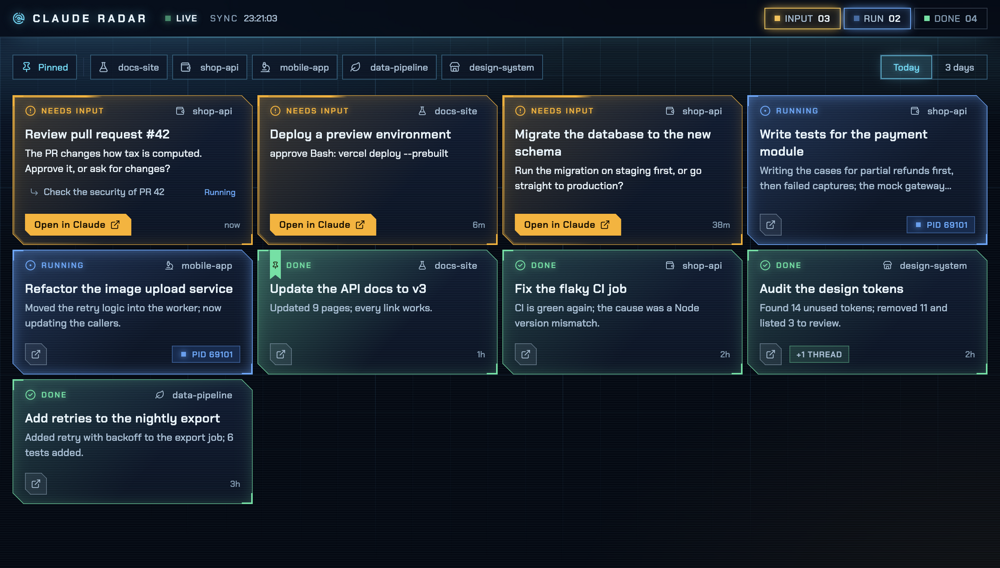
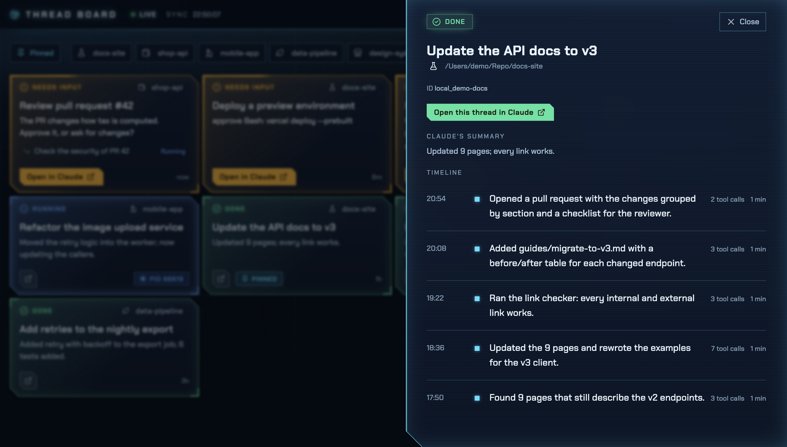
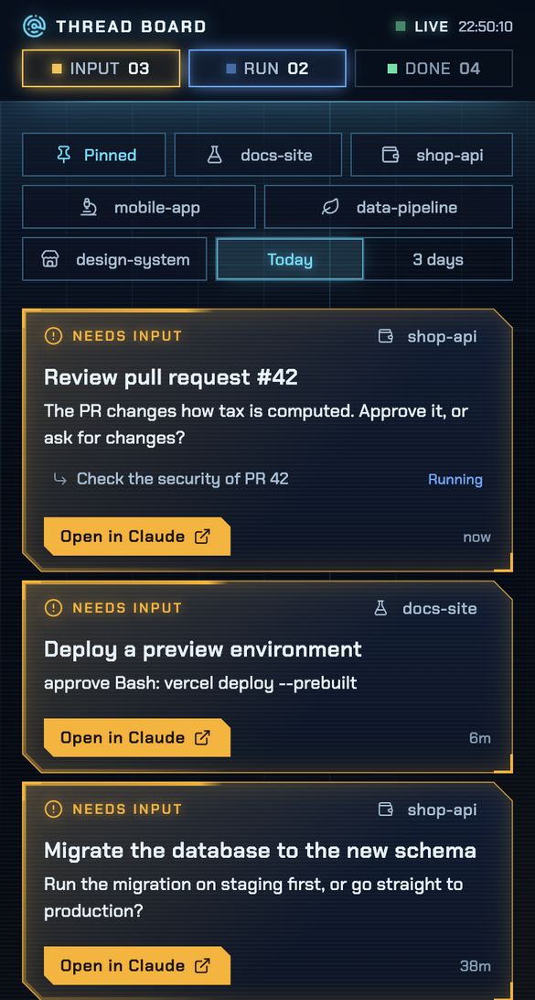

# Claude Radar

*(formerly Thread Board)*

A **read-only** Kanban board for Claude Code threads in **Claude desktop**: which threads need you, which are running, which are done, and what each project (folder) is up to.



No dependencies, no plugins or hooks installed into Claude, nothing written to `~/.claude` or the app's data. To reply to a thread you still open it in Claude desktop.

All pictures in this README use **made-up data** (see [Try it without Claude desktop](#try-it-without-claude-desktop)); none of them shows a real thread.

## Run

```bash
npm start        # http://127.0.0.1:4848  (change the port: PORT=5000 npm start)
```

Requires Node 22 or later. The server listens on `127.0.0.1` only and rejects other Host headers, so thread titles and summaries never leave your machine. By default the server makes **no outbound network calls and reads no API keys**; the one exception is the opt-in [Quotas panel](#quotas-opt-in).

### Try it without Claude desktop

```bash
npm run demo     # http://127.0.0.1:4868, a board of made-up threads (nothing real is read or written)
```

`demo/data.mjs` writes fake thread files, a fake process registry and fake conversations into a temporary folder and points the board at it. The same data produces the pictures in this README (`npm run screenshots`, which needs `npm install` for Electron).

### All scripts

| Script | What it does |
| --- | --- |
| `npm start` | Runs the board on port 4848 |
| `npm run dev` | Same, restarting the server when its code changes (`node --watch`) |
| `npm run demo` | The board with made-up data, port 4868 |
| `npm test` | Unit and server tests (`node --test`) |
| `npm run check` | Type-checks `lib/` and `server.js` (JSDoc and `checkJs`, no build step; needs `npm install`) |
| `npm run app` | Runs the Mac app straight from source |
| `npm run build` | Builds `dist/mac-arm64/Claude Radar.app` (see below) |
| `npm run icons` | Regenerates the app icons (`desktop/make-icons.mjs`) |
| `npm run screenshots` | Regenerates `docs/*.png` from the made-up data |

## Interface



- **Sci-fi HUD style, dark only.** A sticky top bar with the radar brand mark, a **LIVE** (or DISCONNECTED) light and the last **SYNC** time on the left, and the **INPUT / RUN / DONE** counters on the right. Deep navy background with a faint two-level grid and a slow moving beam. Cards are glass panels with two chamfered corners and corner brackets. One font family (Chakra Petch), except code (JetBrains Mono). No rounded corners. Motion is switched off when the system asks for reduced motion.
- **Fonts** (Chakra Petch, JetBrains Mono, Be Vietnam Pro as a fallback for Vietnamese glyphs) are bundled in `public/fonts/` (SIL OFL licenses: `LICENSE-font-*`), so the page loads nothing from the network.
- **Board:** one grid of cards flowing left to right: **needs input first, then running, then done** (each group newest first). Pinned threads are not moved up; a solid bookmark ribbon with a pin hangs from the top edge of the card in its status color, in place of the status icon (the label keeps its position), and the card is tinted more.
  - Card header: the status on the left, the project icon and folder name on the right.
  - Body: the title, a one-line summary (see below), and the child threads with their status (only while the group is not done).
  - Footer: the open button, the "+N THREAD" chip, and the time on the right (`now`, `5m`, `2h`, `3d`). A running card shows a `PID` chip in place of the time.
  - A child thread lives inside its parent's card. The card's status is the worst of the whole group (needs input > running > done), so a parent is only "done" when all children are.
- **Colors and effects tell the status** (the label and icon say it too, so it never relies on color alone). Amber = needs you: the card has a beam of light running around its border. Blue = running: the border brightens and softens again, endlessly. Green = done: static. Every card has its own animation clock that starts when it enters its status, so two cards that changed 2 seconds apart are 2 seconds apart in rhythm. When a card changes status its color eases over a second, the border flashes once, the content fades in and the card slides to its new place; new cards rise in and removed cards fade out.
- **Counters** in the top bar double as status filters: click one to see only that status, click again to clear. A counter lights up when it has something to show (INPUT and RUN above zero, DONE only when there is nothing to do); the INPUT and RUN lamps blink.
- **Filter chips:** Pinned and one chip per project folder, all toggles (click to filter, click again to clear). Each folder has its own [Lucide](https://lucide.dev) icon (bundled in `public/icons.js`, ISC license in `LICENSE-lucide`), stable by name and unique among the folders present. The icon has no color of its own: it follows the card's status color on a card, and in the chips it is part of the label.
- **Time range:** a Today / 3 days toggle (default Today; select neither to show everything). It applies only to finished threads; threads that need input or are running always show. With many finished threads the first 24 are shown plus a "Show more" button.
- **Refresh:** every 2 seconds. A board read takes a few milliseconds because file stats are cached by modification time. Threads archived in Claude desktop are hidden.
- **The card summary line:** for a stopped thread, the automatic summary Claude desktop writes after each turn; for a running thread or one without a summary, the latest message (a trimmed chat excerpt, or your message if Claude has not answered yet), because the summary only exists once a turn ends. If a child thread decides the group's status, its line is shown with the child's name.
- **Narrow screens:** the title stays on the left and the status on the right in the first row, the three counters share the second row, and the chips and time range wrap below.



Every thread can be opened by URL: `#thread=<id>`.

## Opening a thread in Claude desktop

A thread that needs input has a full amber **Open in Claude** button (it opens the exact thread that is waiting for you). Other cards have a small neutral icon button of the same height; on hover it opens up to show the label and fills with the card's status color, while the chips next to it step aside. The detail drawer has a matching button, colored by status as well. The button opens `claude://code/continue?session=<id>` (an id like `local_…`): Claude desktop looks up the unarchived thread with that id and opens it. (The `needs-input` link only opens threads the app itself considers waiting, so a thread that merely stopped to ask would land in a new session; that is why it is not used.) For a group with child threads the button opens the thread that is waiting for you.

Note: this link is not officially documented (only `claude://code/new` is; `continue` was found in the app's code) so it may change between versions. Archived threads cannot be opened. Verified on Claude desktop 4.23118.0 (macOS). If the button ever opens a new session instead of the thread, a newer app version may have changed the link. The browser asks once whether to open Claude. If nothing happens, open the thread from Claude desktop's own list; the page never sends or writes anything to Claude.

## Work list (the detail drawer)

Click a card (or a child thread) to open the drawer. For a group with several threads, pick the thread to inspect at the top. The work list shows, newest first, **one row per turn**: a one-line headline, the number of tool calls and the run time. Click a row to see your message, the tools used (name and count only) and Claude's final answer in full, plus the "Created" milestones for the thread and its children. At most the latest 60 turns are shown.

Claude only writes a summary for the **latest** turn of a thread (it is overwritten after every turn) and the transcript has none, so the headline of a turn is the first line of Claude's reply, without markdown marks, clipped to 140 characters.

The work list and the latest-message line are the two features that read **conversation content** (`~/.claude/projects/*/<id>.jsonl`). The work list is read only when you open a thread; the latest-message line reads only the tail of each file (1 MB, growing up to 32 MB if that part holds only tool results) and is cached by modification time. Text is trimmed (240 characters for the card line; at most 700 and 1600 characters for your message and the answer, rendered as markdown); Claude's thinking and tool contents or results are never kept or sent. The server only listens on `127.0.0.1`.

## Data and how status is derived

| Source | Used for |
| --- | --- |
| `~/Library/Application Support/Claude/claude-code-sessions/*/*/local_*.json` | Every thread: title, folder, parent thread (`spawnedFrom`), pinned (`isStarred`), archived, end-of-turn summary (`postTurnSummary`) |
| `~/.claude/sessions/<pid>.json` | Running threads: `status` is `busy`, `idle`, `waiting` or `shell` |
| `~/.claude/projects/*/<cliSessionId>.jsonl` | The latest message on the card (tail read) and the work list (when you open a thread) |

Order of precedence, as in `threadStatus` in `lib/model.js`:

1. A process that is `waiting` (for a permission, etc.) → **Needs input**; `busy` or `shell` → **Running** (the summary at that point belongs to the previous turn, so it is labeled "Previous turn").
2. End-of-turn summary: `blocked` or `review_ready` → **Needs input**; `completed` → **Done**.
3. No summary: process alive → **Running**; process gone → **Done**, shown as "No summary yet".

A thread is linked to its process by `hostSessionId` (then the CLI `sessionId`). A child whose parent is archived or missing stands on its own. A project's folder is `originCwd` (worktrees fold into the main project).

## Build the Mac app

There is no prebuilt download: build it yourself (about two minutes). Requirements: macOS, Node 22 or later, and the Xcode command line tools (`xcode-select --install`, for `sips` and `iconutil`).

```bash
git clone https://github.com/phamviet86/claude-radar.git
cd claude-radar
npm install          # installs Electron and electron-builder (dev-only; the board itself has no dependencies)
npm run build        # -> dist/mac-arm64/Claude Radar.app  (dist/mac-x64 on Intel Macs)
```

Then drag `Claude Radar.app` from `dist/` into Applications and open it. The build is not code-signed or notarized; because you built it on your own Mac, macOS runs it without complaint. If you copy the `.app` to another Mac (AirDrop, zip) macOS will block it: run `xattr -cr "/Applications/Claude Radar.app"` once, or build it on that Mac instead.

**What you get.** Opening the app shows the board window; closing the window only hides it. A radar icon on the menu bar shows the `INPUT · RUN` counts (refreshed every 2 seconds), opens the window on click, and its right-click menu has "Launch at login" and "Quit". The app runs the same read-only server inside itself on `127.0.0.1:4858` (a free port if that one is taken), so it can run next to `npm start` (port 4848). Its own settings (the saved filters) live in `~/Library/Application Support/claude-radar`; it still writes nothing to Claude's data.

**Troubleshooting.** If macOS asks whether Claude Radar may access data from other apps, allow it: it reads Claude desktop's thread files. If the menu-bar counts show `×`, the built-in server could not be reached; quit and reopen the app.

## Quotas (opt-in)

A collapsed **QUOTAS** panel under the top bar (it shows "Chưa bật" until a key is set). It is the only part of Claude Radar that can make an outbound call, and only when you set a key.

| Provider | What it shows | Needs |
| --- | --- | --- |
| Claude | **ƯỚC TÍNH** (estimate): tokens used in the last 5 hours and last 7 days, summed from your local transcripts (input + output + cache creation; rolling windows, not your plan's reset times). No percentage: the plan limits are only on claude.ai, linked from the card. | nothing (local files, no network) |
| Firecrawl | credits remaining of the plan and the billing period end, from `GET https://api.firecrawl.dev/v2/team/credit-usage` | `FIRECRAWL_API_KEY` |
| Crawl4AI Cloud | free credits, bought credits and spend this month, from `GET https://api.crawl4ai.com/v1/billing/balance` (read-only; found in the console's API reference, not on the public docs page). No limit is shown, so no "sắp hết" flag. | `CRAWL4AI_API_KEY` |
| Perplexity | **không khả dụng** (checked 2026-11-08): no balance API; the card links to the billing page of the console | - |

Checked 2026-11-08 against the Firecrawl API reference, the Crawl4AI console API reference and the Perplexity docs.

```bash
FIRECRAWL_API_KEY=fc-... CRAWL4AI_API_KEY=sk_live_... npm start     # or put the lines in a gitignored .env (see .env.example): npm start / npm run dev / npm run app load it
```

A built `.app` opened from Finder does not see your shell variables: put the same line in `~/Library/Application Support/claude-radar/.env`, or start it from a terminal instead: `FIRECRAWL_API_KEY=fc-... "/Applications/Claude Radar.app/Contents/MacOS/Claude Radar"`.

- **Low warning:** for a provider with a known limit (Firecrawl), under 20% remaining shows the text "sắp hết" on its card and a **SẮP HẾT** light in the top bar. The menu-bar icon is unchanged.
- **What leaves your machine:** only the Firecrawl and Crawl4AI balance requests (your key as a Bearer header, to `api.firecrawl.dev` / `api.crawl4ai.com` over HTTPS, 8 s timeout, `GET`, no redirects). The key is read from the environment on the server, never logged, never sent to the page, never written to disk, and errors show fixed phrases only.
- **No traffic from the page refresh:** the server caches each external answer for **5 minutes** (errors too, no retries); the page asks `/api/quotas` every 15 s and only gets the cached answer. No endpoint that changes spending is ever called (Crawl4AI's `/v1/billing/topup`, `/subscribe` and `/settings` are never touched).
- `npm run demo` and `npm run screenshots` use a fake key and a fake `fetch` whatever your environment holds; tests use mocks only.

## Known limits

- "Needs input" and "Done" rely on a summary Claude writes itself after each turn, so they are sometimes wrong.
- This is Claude's internal format and may change between versions. When it cannot be read, the page shows a warning instead of failing.
- Only threads on this machine are visible (no SSH or cloud sessions). Multiple Claude configurations are not supported (`CLAUDE_CONFIG_DIR` takes a single directory).
- Claude's summaries are sometimes truncated or out of step with the last message; the latest message can be long or just "Done.".
- The board does not show your plan's own usage bars (the 5-hour and weekly limits): Claude has no public endpoint for them. The [Quotas panel](#quotas-opt-in) shows only a local token *estimate*.

## Environment variables

| Variable | Effect |
| --- | --- |
| `PORT` | Port (default 4848; 4868 for `npm run demo`) |
| `CLAUDE_RADAR_DESKTOP` | Claude desktop's thread directory; `off` to disable |
| `CLAUDE_CONFIG_DIR` | Claude Code config directory (default `~/.claude`) |
| `FIRECRAWL_API_KEY`, `CRAWL4AI_API_KEY` | Opt-in: turn on the Firecrawl / Crawl4AI credits cards (see [Quotas](#quotas-opt-in)) |

## Project layout

| Path | What is in it |
| --- | --- |
| `server.js` | The local read-only HTTP server (`/api/board`, `/api/timeline`, static files) |
| `lib/model.js` | Pure board model: status of each thread, grouping, day buckets |
| `lib/read.js` | Reads Claude's files from disk, with caching and warnings |
| `lib/timeline.js` | Turns a conversation transcript into the work list and the latest message |
| `lib/quotas.js`, `lib/usage.js` | The opt-in Quotas panel: Firecrawl credits (cached call) and the local Claude token estimate |
| `public/` | The page: `index.html`, `app.js`, `style.css`, bundled fonts and icons |
| `desktop/` | The Electron wrapper (menu bar icon, window) and the icon scripts |
| `demo/` | Made-up data, `npm run demo` and the screenshot script |
| `test/` | Tests for the model, the reader, the server and the transcript parser |
